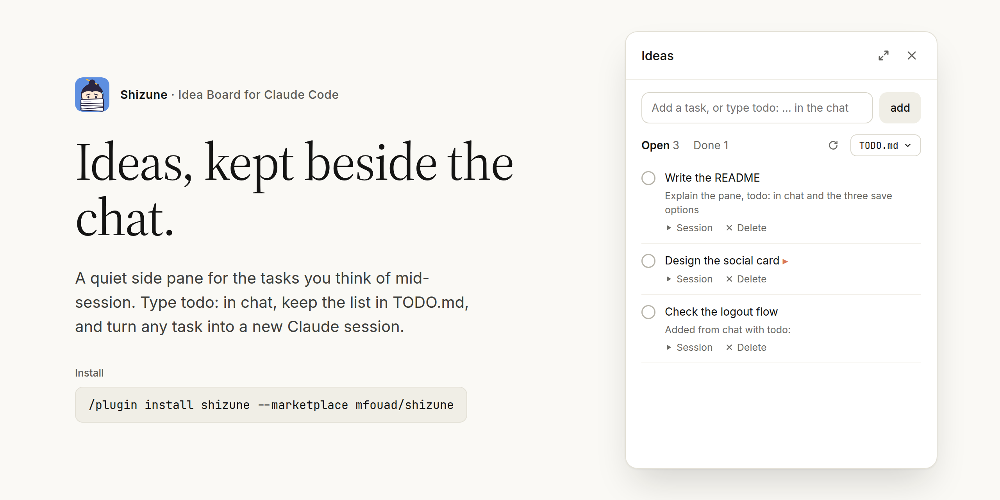
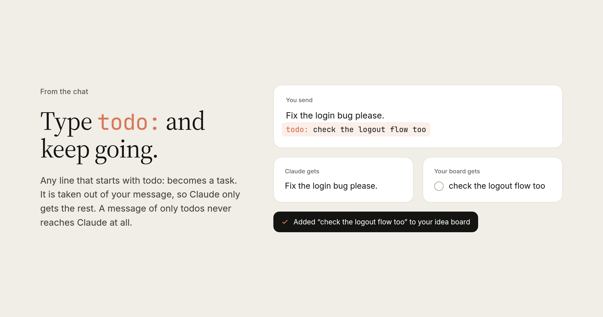
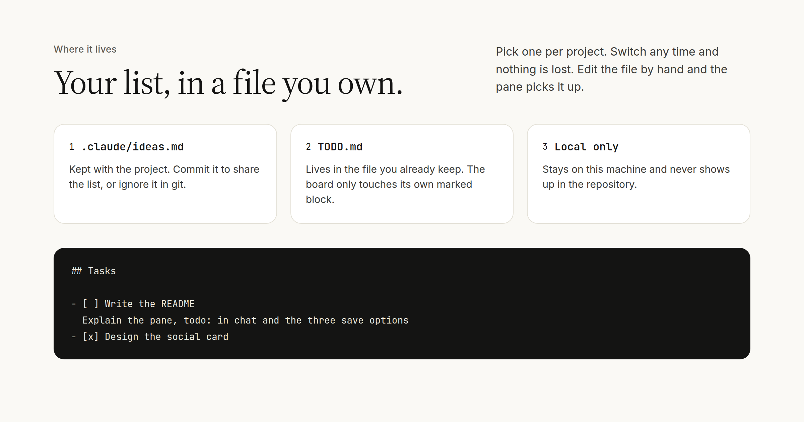

<p align="center">
  
</p>

<p align="center">
  
</p>

<h1 align="center">Shizune</h1>

<p align="center">
  Your assistant for Claude Code, for when you're buried in work.
</p>

---

You're the leader with a desk full of paperwork. Shizune is the assistant who
keeps it in order. This repository is a Claude Code plugin, `shizune`, that
collects the mods I write for running work with Claude.

## Idea Board

The first mod. A task list in a pane beside the chat, so the ideas you have
mid-session don't get lost.

<p align="center">
  <a href="idea-board/"></a>
</p>

- **Add tasks** in the pane, or type `todo:` at the start of a line in any
  message. That line becomes a task and is taken out of what Claude gets.
- **Keep the list** in `.claude/ideas.md`, `TODO.md` or only on your machine.
  It's plain Markdown you can edit by hand.
- **Start a session** from any task with one button.
- Close the pane and type `/ideas` to open it again.

<p align="center">
  
  
</p>

Read more in the [Idea Board guide](idea-board/).

More is on the way: agent status, security checks and task triage. See [PLANNED.md](PLANNED.md).

## Installing

Everything here installs as one plugin, `shizune`. At the prompt of a Claude Code
terminal session:

```
/plugin install shizune --marketplace mfouad/shizune
```

From a shell:

```bash
claude plugin install shizune --marketplace mfouad/shizune
```

In the Claude desktop app: click **+** next to the prompt box, then
**Plugins**, **Add marketplace** with `mfouad/shizune`, then **Add plugin**.

## Adding a new mod

1. Put the mod in its own folder at the top level, with its hooks module and a
   `README.md`, and add the module to the `modules` list in
   `hooks/hooks.json`.
2. Declare any `$.state` values the mod keeps in `types/index.d.ts`, under
   `'shizune'`.
3. Give it a section in this README. Images go in `images/`.
4. Run `claude plugin validate .` and `claude plugin test .`.

## About the name

[Shizune](https://naruto.fandom.com/wiki/Shizune) (静音, "quiet sound") is a Japanese given name, and the persona is a
nod to the hard-working apprentice of Tsunade in *Naruto*, and later she assisted her as the 5th Hokage leading Konoha shadow-village. 
From the *Naruto* anime; the characters and footage belong to their rights
holders.
