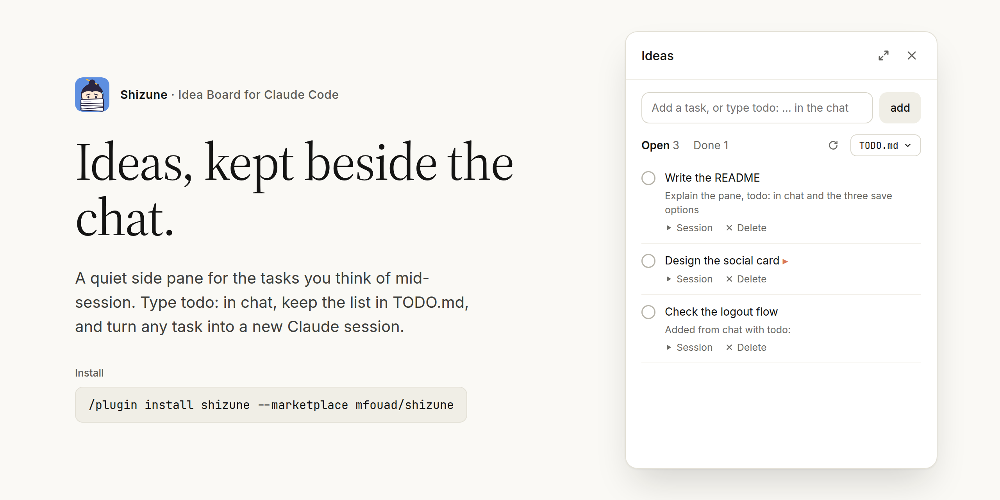
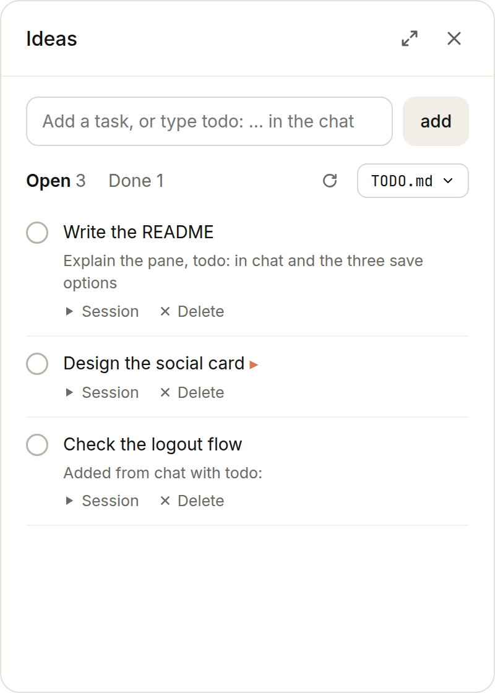
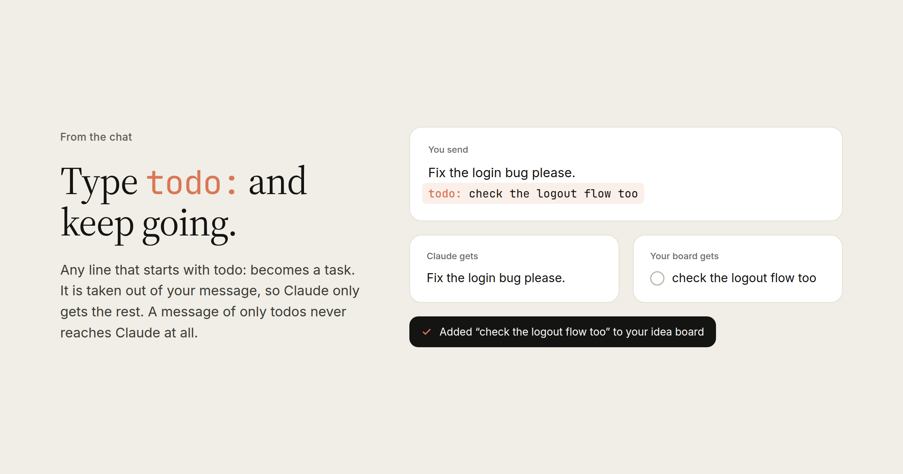
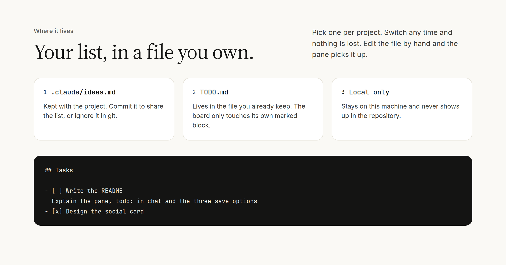

<p align="center">
  
</p>

# Idea Board

A mod in [Shizune](../README.md) that keeps a small task list in a pane beside the chat. You
can add tasks while you work, type `todo:` in a message to add one without
leaving the chat, and start a new Claude session from any task.

It works in the Claude desktop app (Code tab) and in the terminal.

## Install

Idea Board comes with Shizune. At the prompt of a Claude Code terminal session:

```
/plugin install shizune --marketplace mfouad/shizune
```

From a shell:

```bash
claude plugin install shizune --marketplace mfouad/shizune
```

In the Claude desktop app, where `/plugin` does not run: click **+** next to
the prompt box, then **Plugins**, **Add marketplace** with `mfouad/shizune`,
then **Add plugin**.

Once it is installed, the pane opens when a session starts. If you close it,
type `/ideas` to open it again.

## Using it

### The pane

<p align="center">
  
</p>

- **Add a task** in the field at the top and press Enter, or click **add**.
  The first line is the title, and any further lines are shown as detail
  under it.
- **Tick the circle** to mark a task done. **Open** and **Done** switch
  between the two lists, and **Clear done** removes finished tasks.
- **▶ Session** puts a request for a new Claude session into your prompt box,
  with the task as its brief. Press Enter to send it. A small orange `▸`
  marks tasks you have started a session for.
- **✕ Delete** removes a task.

### `todo:` in the chat

<p align="center">
  
</p>

Any line of a message you send that **starts** with `todo:` (any
capitalisation) is added to the board and taken out of the message:

| You send | What happens |
| --- | --- |
| `todo: write the README` | The task is added and the message is not sent. You see a note saying it was added. |
| Several lines that all start with `todo:` | All of them are added and the message is not sent. |
| A request plus a `todo:` line | The task is added, the `todo:` line is cut out, and Claude gets the rest. A notification says what was added. |

`todo:` in the middle of a sentence is left alone. Only messages you type (or
send from Remote Control) are read: slash commands and messages from other
plugins or background tasks are never changed.

### Where the list is saved

<p align="center">
  
</p>

Pick one per project folder from the dropdown at the top right of the pane:

| Option | Where | Good for |
| --- | --- | --- |
| `.claude/ideas.md` | In the project folder | Keeping the list with the code. Commit it to share it, or ignore it in git. |
| `TODO.md` | At the root of the project folder | Using a TODO file you already keep. The board only edits its own marked block and leaves the rest of the file alone. |
| Local only | On this machine | Lists that should never show up in the repository. |

Switching keeps everything: tasks already in the new place are merged with the
current list. A copy is always kept locally as a backup.

The file is plain Markdown, so you can edit it by hand:

```markdown
<!-- idea-board:start (managed by Shizune; edit freely, keep these markers) -->

## Tasks

- [ ] Write the README <!-- ib:{"id":"…","c":…} -->
  Explain the pane, todo: in chat and the save options
- [x] Design the social card <!-- ib:{"id":"…","c":…} -->

<!-- idea-board:end -->
```

Keep the two marker comments. The `ib:` comment after each task holds its id;
a task you add by hand without one is given one. The pane reloads the file
after each Claude turn, or when you click **⟳**.

## Developing

```
idea-board/
├── register.tsx        the mod
├── register.test.tsx   tests
└── README.md           this file
```

The mod is loaded by Shizune's `hooks/hooks.json`, and its state types are in
`types/index.d.ts` at the repository root. From the repository root:

```bash
claude --plugin-dir .
```

```bash
claude plugin validate .
```

```bash
claude plugin test .
```

## Designs

The images in [`images/`](../images/) are exports of the Shizune design canvas
(hero, pane, `todo:` in chat, save options), drawn in Claude's palette: Ivory
`#FAF9F5`, Slate `#141413` and Clay `#D97757`, with a serif headline over a
sans body.
